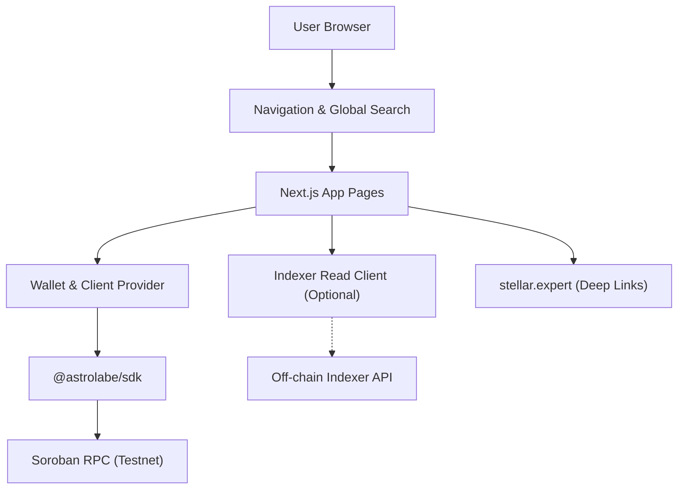

# astrolabe-explorer

The web app for **Astrolabe**, an open attestation registry on Stellar's Soroban
platform. Browse schemas, look up a subject's attestations, and issue or revoke
attestations from a connected wallet, all on Testnet.

> **Status:** unaudited, Testnet only.

## The Three Repositories

Astrolabe ships as three repositories; dependencies point one way and never
reverse:

```
astrolabe-contracts  ->  astrolabe-sdk  ->  astrolabe-explorer
```

- **[astrolabe-contracts](https://github.com/soroban-dev-tools/astrolabe-contracts)**
  — the Soroban contracts and deployment truth.
- **[astrolabe-sdk](https://github.com/soroban-dev-tools/astrolabe-sdk)** — the
  TypeScript client.
- **astrolabe-explorer** (this repo) — this Next.js app.

The app talks to Soroban **only through `@astrolabe/sdk`**. It never imports
contract bindings directly. If the app needs something the SDK cannot do, the fix
goes in the SDK.

## Features

- **Schema Directory** — lists registered seed schemas on Testnet with field definitions, authority, and attestation metrics.
- **Recent Attestations** — paginated listing of recent schema attestations powered by an optional off-chain indexer, with seamless fallback to on-chain lookups.
- **Subject Attestation View** — browse attestations by subject address with typed field payload decoding, raw hex fallback, validity indicators, and issuer revocation controls.
- **Issuance Flow** — dynamic form rendering based on schema field definitions, future expiration validation, and ledger timestamp conversion.
- **Global Search** — header search resolving Stellar accounts (`G...`), contracts (`C...`), 32-byte schema UIDs, and fuzzy seed schema names.
- **Explorer & Clipboard Integration** — direct deep links to [stellar.expert](https://stellar.expert) for accounts, contracts, and transactions, paired with accessible copy buttons.
- **Toast Feedback & Error Translation** — non-blocking notifications decoding Soroban contract errors (trap codes #1–#9) into plain English messages.
- **Zero-Wallet Reads** — every page works with no wallet connected; only signing an attestation or revocation requires a wallet.

## Architecture



## Quick Start

### Prerequisites

- Node.js 20+
- pnpm 11+ (`corepack enable` provides pnpm)

```bash
# Clone the repository
git clone https://github.com/soroban-dev-tools/astrolabe-explorer.git
cd astrolabe-explorer

# Install dependencies
pnpm install

# Start development server
pnpm dev
# Open http://localhost:3000
```

Reads work immediately against public Testnet. To issue or revoke attestations,
connect a Testnet wallet (such as Freighter, xBull, Albedo, or Lobstr) via the
header Connect button.

### Configuration

Copy `.env.example` to `.env.local` to override default settings:

```bash
cp .env.example .env.local
```

| Variable                      | Description                         | Default                               |
| ----------------------------- | ----------------------------------- | ------------------------------------- |
| `NEXT_PUBLIC_SOROBAN_RPC_URL` | Soroban RPC endpoint                | `https://soroban-testnet.stellar.org` |
| `NEXT_PUBLIC_INDEXER_URL`     | Optional off-chain indexer base URL | _(unset, degrades to direct lookups)_ |
| `CONSTELLATION_DEPLOYMENTS`   | Path to local deployment JSON file  | _(uses vendored SDK deployments)_     |

### Local Multi-Repo Development

To run against a local contract deployment, set `CONSTELLATION_DEPLOYMENTS`:

```bash
CONSTELLATION_DEPLOYMENTS=../astrolabe-contracts/deployments/local-testnet.json pnpm dev
```

For SDK development across local checkouts:

```bash
# In astrolabe-sdk
pnpm build && pnpm link --global

# In astrolabe-explorer
pnpm link --global @astrolabe/sdk
```

## Available Scripts

| Script              | Command              | Purpose                                         |
| ------------------- | -------------------- | ----------------------------------------------- |
| `pnpm dev`          | `next dev`           | Start development server on port 3000           |
| `pnpm test`         | `vitest run`         | Run comprehensive unit and component test suite |
| `pnpm test:watch`   | `vitest`             | Run tests in interactive watch mode             |
| `pnpm lint`         | `next lint`          | Run ESLint checks                               |
| `pnpm typecheck`    | `tsc --noEmit`       | Validate TypeScript types strictly              |
| `pnpm format`       | `prettier --write .` | Format all source and documentation files       |
| `pnpm format:check` | `prettier --check .` | Verify code formatting compliance               |
| `pnpm build`        | `next build`         | Create optimized production build               |

## Contributing

Contributions are welcome! Please read our [Contributing Guide](CONTRIBUTING.md)
and [Code of Conduct](CODE_OF_CONDUCT.md) before opening a pull request.
Security considerations are documented in [SECURITY.md](SECURITY.md).

## License

Apache-2.0. See [`LICENSE`](LICENSE).
